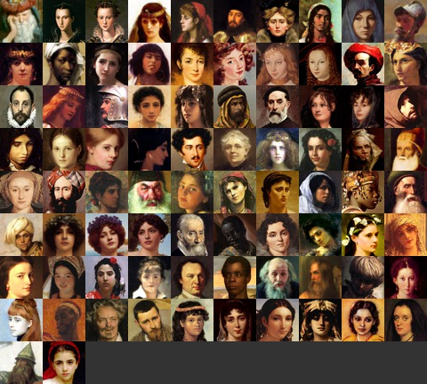

# assets-2d-portraits

2D 인물 초상화 에셋 저장소입니다. 자체 제작(AI 생성) 초상화를 수록합니다. 출처: 소유자의 다른 AI 어시스턴트 'Instinct'가 AI로 생성한 자체 작업물(own work, AI-generated by Instinct)이며 소유자 결정으로 수록·유지합니다(2026-11-08, A15). CC0로 표기하지 않습니다.

## 팩 목록

### 삼국지 수묵담채 초상화 660

수묵담채 화풍의 삼국지 무장 초상화 660장입니다.

- 내용: 개별 PNG 656장(1254×1254) + 사용자 승인 원본 JPG 4장(512×512, `originals/`)
- 인물 정보: `portraits-index.json` — 인물 번호·한자명·한국어명 (한국어명 미확정 204명은 `name_ko_unconfirmed`에 표기)
- 인물 번호는 삼국지11 팬 정리 인물 목록 기준입니다. 역사 인물의 이름·한자명은 사실 자료입니다.
- 다운로드: [Releases v1.0](../../releases) 의 분할 zip 조각 4개(`samgukji-portraits-660.zip.part1~4`)를 모두 같은 폴더에 받은 뒤 합쳐서 압축 해제하세요.
  - 재결합: `cat samgukji-portraits-660.zip.part* > samgukji-portraits-660.zip` (Windows: `copy /b samgukji-portraits-660.zip.part1+samgukji-portraits-660.zip.part2+samgukji-portraits-660.zip.part3+samgukji-portraits-660.zip.part4 samgukji-portraits-660.zip`)
  - 전체 zip 약 2.1GB (PNG 656 + JPG 4 + portraits-index.json + LICENSE.txt)
- 출처·라이선스: 자체 제작(소유자 보유), Instinct(소유자의 AI 어시스턴트)가 AI로 생성, 소유자 결정으로 유지 (own work, AI-generated by Instinct, kept by owner decision) · 조건 없이 사용 가능 (저작자 표시 불요, 상업적 이용·수정·재배포 허용) — `LICENSE.txt`
- AI 생성물 특성상 동일하거나 유사한 이미지가 다른 곳에 존재할 수 있으며 독점적 권리를 보장하지 않습니다.

### public domain portraits

- 파일: [릴리스  첨부 다운로드](https://github.com/sigco3111/assets-2d-portraits/releases/download//public-domain-portraits.zip) (6.7MB, png 82개 · txt 1개 · jpg 1개)
- 제작: remaxim / 라이선스: CC0 / 원본: https://opengameart.org/content/public-domain-portraits

### RPG portraits

- 파일: [릴리스  첨부 다운로드](https://github.com/sigco3111/assets-2d-portraits/releases/download//rpg-portraits.zip) (49KB, png 3개)
- 제작: Mumu / 라이선스: CC0 / 원본: https://opengameart.org/content/rpg-portraits

