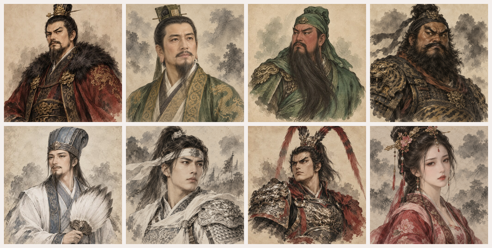

# assets-2d-portraits

2D 인물 초상화 에셋 저장소입니다. 자체 제작(AI 생성) 초상화를 수록합니다.

## 팩 목록

### 삼국지 수묵담채 초상화 660

수묵담채 화풍의 삼국지 무장 초상화 660장입니다.

- 내용: 개별 PNG 656장(1254×1254) + 사용자 승인 원본 JPG 4장(512×512, `originals/`)
- 인물 정보: `portraits-index.json` — 인물 번호·한자명·한국어명 (한국어명 미확정 204명은 `name_ko_unconfirmed`에 표기)
- 인물 번호는 삼국지11 팬 정리 인물 목록 기준입니다. 역사 인물의 이름·한자명은 사실 자료입니다.
- 다운로드: [Releases v1.0](../../releases) 의 분할 zip 4개를 모두 받아 같은 폴더에 압축 해제
- 라이선스: 자체 AI 생성 · 조건 없이 사용 가능 (저작자 표시 불요, 상업적 이용·수정·재배포 허용) — `LICENSE.txt`
- AI 생성물 특성상 동일하거나 유사한 이미지가 다른 곳에 존재할 수 있으며 독점적 권리를 보장하지 않습니다.

